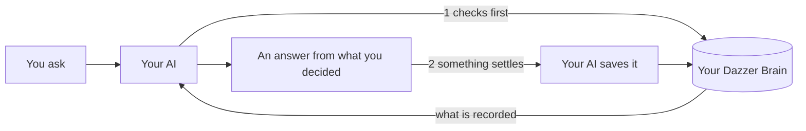

# Dazzer

Your AI checks your Dazzer Brain before it answers, and saves what settles before the chat ends.

For anyone who keeps a Dazzer Brain and works with an AI tool: Claude, Codex, GitHub Copilot,
Cursor, Antigravity or Devin. Your Brain holds what you and your team know and decide. This plugin
makes your AI use it, so you stop repeating yourself and nothing settled is lost when a chat closes.



The connection lets your AI open your Brain. This plugin is what reminds it to look there first,
without you asking.

## Supported tools

| Tool | Checks your Brain first | Saves what settles | Picks up after a reset | Guide |
| --- | --- | --- | --- | --- |
| Claude: Claude Code and the desktop app | Yes | Yes | Yes | [Install](docs/install.md#claude) |
| ChatGPT and Codex | Yes, in Codex | Yes, in Codex | Yes, in Codex | [Install](docs/install.md#chatgpt-and-codex) |
| GitHub Copilot | Yes | No | No | [Install](docs/install.md#github-copilot) |
| Cursor | Yes | Yes, shown in the chat | Yes | [Install](docs/install.md#cursor) |
| Antigravity | Yes | Yes | No | [Install](docs/install.md#antigravity) |
| Devin | Yes | No | Yes | [Install](docs/install.md#devin) |

In Claude's chat and web apps no reminder can run, so the plugin's skill carries the same intent as
plain text. The install steps cover Codex; the ChatGPT app has no steps in this guide yet.

You need a Dazzer Brain to use it. See [dazzer.io](https://dazzer.io).

## Quick start

In Claude Code, type these into Claude itself, not into your shell:

```text
/plugin marketplace add dazzer-io/dazzer-plugin
/plugin install dazzer@dazzer
/plugin install dazzer-connect@dazzer
```

Then close Claude Code, start it again, and sign in when it asks. Installing does not sign you in,
on any tool.

To check it worked, ask your AI what your Brain already knows about you. Real records back means it
is connected. A shrug, a file it found or a summary of your own chat means it is not.

Every other tool, signing in, staying up to date and removing it: [docs/install.md](docs/install.md).

## What it does

- **Checks before answering.** A short reminder tells your AI to look in your Brain before
  answering anything you may have told it before, and to say so plainly when it cannot reach the
  Brain rather than guess.
- **Saves what settles.** Once enough real work has built up, your next message quietly carries a
  prompt to save it. Your AI decides what is worth keeping, by your Brain's own rules, and tells you
  in one line what it saved.
- **Picks up after a reset.** When a long chat is compacted, your AI is told to restore its saved
  place before carrying on. Each chat gets its own place back, not another chat's.
- **Shows your plate, if you want it.** In Claude Code, an optional pane opened with `/plate` lists
  what needs you now, what is waiting on someone else and what is coming up.

## What it never does

- **It never holds your credentials.** The reminders carry no connection at all, so installing them
  cannot disturb a connection you already have. Your tool's own connection is what signs in.
- **It never decides what is saved, and never writes to your Brain.** Your AI does the saving,
  through its own connection, by the rules your Brain serves.
- **It never keeps your conversation.** On disk it writes only a short run log of when it ran, what
  it decided and why, and a small marker per chat.
- **It never posts in your name unasked.** Only the plate pane sends your AI a sentence as you,
  and only when you use it.
- **It never carries the rules.** They live in your Brain, so a change there takes effect at once,
  with nothing for you to update.

## An example

An invented exchange in Claude Code, for a team whose Brain already records a pricing decision:

```text
You:  Where did we land on the pricing page?

AI:   From your Brain: on 4 November you chose two plans, Starter and Team,
      and Nadia Brook owns the page copy. Nothing newer is recorded.

You:  Let's drop Starter. Team only, from January.

AI:   Saved to your Brain: pricing is Team only from January. It replaces
      the two-plan decision.
```

The first answer came from the Brain, not from a guess. The second line is the save: one line,
saying what was kept.

## Learn more

- [Install, sign in and update](docs/install.md): every tool, step by step, and how to remove it.
- [How it works](docs/how-it-works.md): when each reminder arrives, what is stored, and the
  settings you can change.
- [Decisions](docs/decisions/): why it is built the way it is.

## Support

Questions, problems and ideas: [open an issue](https://github.com/dazzer-io/dazzer-plugin/issues).

## Security

Please do not report a security problem in a public issue. Follow the
[security policy](https://github.com/dazzer-io/dazzer-plugin/security/policy) to report it
privately.

## Licence

The code is released under the [MIT licence](LICENSE).

The Dazzer name and logo are trademarks of Dazzer. You are welcome to use the name to refer to
this project, but not in a way that suggests Dazzer endorses you, your product or your service.
