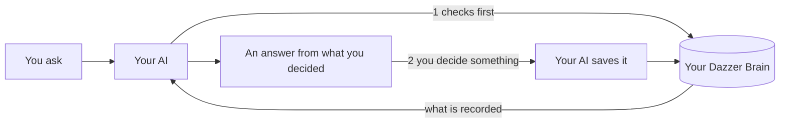

# Dazzer

Your AI checks your Dazzer Brain before it answers, and saves what you decide so the next chat starts from it.

A Dazzer Brain is a shared record of what you and your team know and decide: decisions, facts,
preferences and corrections, kept by Dazzer so the AI tools you work with can read it. You need a
Dazzer account to have one; see [dazzer.io](https://dazzer.io). These plugins make your AI tool use
it. A new Brain starts empty, so on day one your AI mostly finds nothing and says so; it fills as
you work.

For people who work in Claude Code, Codex, GitHub Copilot, Cursor, Antigravity or Devin.



## What you install

- **`dazzer`, the reminders.** Short notes added to what your AI reads at set points in a chat, so
  it checks your Dazzer Brain before it answers and saves decisions and facts to it as they come up.
  They add no connection of their own, so they are safe beside one you already have.
- **`dazzer-connect`, the connection**, which the reminders need to reach your Brain. It signs your
  tool in to your Brain, so your AI can read from it and save to it. Install it alongside them;
  signing in is a separate step, described in the [install guide](docs/install.md).
- **`dazzer-plate`, the plate pane.** Optional, Claude Code only: a pane listing your open items
  from your Brain.

Antigravity needs one more piece, `dazzer-antigravity`: the reminders in Antigravity's own format.

## Supported tools

What reaches your AI in each tool, as tested so far. "After compaction" is the note your AI gets
when the tool shortens a long chat to make room, which can drop what your AI was told earlier.

| Tool | Check before answering | Prompt to save | After compaction | Not yet confirmed | Guide |
| --- | --- | --- | --- | --- | --- |
| Claude Code, in a terminal or the Claude desktop app | At the start of each chat | With your next message | Yes, with this chat's saved progress | Whether it asks you to approve the reminders | [Install](docs/install.md#claude-code) |
| Codex | At the start of each chat | With your next message | Yes, with this chat's saved progress | Updates, removal | [Install](docs/install.md#codex) |
| GitHub Copilot | From an instruction file you copy in | No | No | Updates, removing the plugins | [Install](docs/install.md#github-copilot) |
| Cursor | At the start of each chat | Posted in your chat as a message | No | Sign-in, removal | [Install](docs/install.md#cursor) |
| Antigravity | With every message | At the end of a reply | No | Sign-in, updates, removal | [Install](docs/install.md#antigravity) |
| Devin | With every message | No | Yes, without a label for the chat | Updates, removal | [Install](docs/install.md#devin) |
| Claude chats outside Claude Code | No | No | No | Not covered | [Why](docs/install.md#claude-chat-apps) |
| ChatGPT app | No | No | No | Not covered | [Why](docs/install.md#chatgpt-app) |

## Quick start in Claude Code

You need Claude Code and a Dazzer account. Type these into Claude Code's own prompt, not into your
shell:

```text
/plugin marketplace add dazzer-io/dazzer-plugin
/plugin install dazzer@dazzer
/plugin install dazzer-connect@dazzer
```

Then restart Claude Code and sign in when it asks. The sign-in uses the Dazzer account your browser
is signed in to. If nothing asks, type `/mcp`, choose `plugin:dazzer-connect:dazzer`, and sign in
there.

Then check it, in a new chat:

1. Ask `What does my Dazzer Brain know about me?` Claude Code shows the call to your Brain in the
   chat. An empty Brain answers that nothing is recorded yet, which still means you are connected.
   If your AI says it cannot reach your Brain, you are not signed in.
2. Tell it `Remember that our project is called Lumen.` It should say it saved that.
3. In another new chat, ask `What is our project called?` The answer comes from your Brain.

More checks, every other tool, updates and removal: [docs/install.md](docs/install.md).

## What reaches your AI, and what leaves your machine

- **To your AI:** short notes that start with `[Dazzer]` or `Dazzer checkpoint`, added to the chat
  your AI reads, like anything you type. They tell it to check your Brain first, to save what was
  decided, and to restore its saved progress after compaction. In Claude Code and Codex the notes
  also carry a label for the chat, made from the id your tool already gives it.
- **Over the network:** the reminders send nothing; they run on your machine. Your tool reaches
  your Brain through the connection at `https://graph.dazzer.io/mcp`, signed in as you, and each
  request names the plugin and its version. What your AI looks up and saves goes there. The plate
  pane asks the same connection for your open items, with your computer's time zone.
- **On disk:** a short run log and a small counter per chat, never what was said. On Copilot, the
  instruction file you copy in. [How it works](docs/how-it-works.md#what-is-stored-on-your-machine)
  has the full list.

## What it does

- **Checks before answering.** Your AI is told to look in your Brain before answering anything you
  may have told it before, and to say so plainly when it cannot reach the Brain rather than guess.
- **Prompts a save.** Once enough of the chat has built up, your AI is asked to save what was
  decided. It chooses what to keep and tells you in one line what it saved. If nothing was
  decided, it says nothing.
- **Restores progress after compaction.** Your AI saves where the work stands as it goes. After
  compaction it is told to restore that before carrying on, so you do not have to repeat yourself.
- **Shows your open items, if you want.** In Claude Code, type `/plate` to open the plate pane:
  what needs you, what waits on others, what is coming up, and what can wait.

## What it never does

- **It never touches a connection you already have** when you install the reminders.
- **It never decides what is saved, and never writes to your Brain itself.** Your AI does the
  saving, through its own connection.
- **It never stores your chat.** To know when to prompt a save it counts the lines of your tool's
  own record of the chat, and keeps only that count.
- **It never posts as you, with two exceptions.** The plate pane's buttons send your AI one
  sentence as your message, only when you press them. In Cursor, the save prompt appears in your
  chat as a message, because Cursor offers no other way.
- **It never carries Dazzer's instructions for what is worth saving or how.** It says only when to
  check and when to save. Your AI reads those instructions from your Brain through the connection,
  so Dazzer can change them without a plugin update.

## An example

An invented exchange in Claude Code, for a team whose Brain already records a pricing decision:

```text
You:  Where did we land on the pricing page?

AI:   From your Brain: on 4 November you chose two plans, Starter and Team,
      and Nadia Brook owns the page copy. Nothing newer is recorded.

You:  Let's drop Starter. Team only, from January.

AI:   Saved to your Brain: pricing is Team only from January. It replaces
      the two-plan decision.
```

The first answer came from the Brain, not from a guess. The last line is the save: one line,
saying what was kept.

## Learn more

- [Install, sign in and update](docs/install.md): every tool, step by step, how to check it works,
  and how to remove it.
- [How it works](docs/how-it-works.md): each note your AI gets and when, what is sent and stored,
  the plate pane, and the settings you can change.
- [Decisions](docs/decisions/): why it is built the way it is.

## Support

Questions, problems and ideas: [open an issue](https://github.com/dazzer-io/dazzer-plugin/issues).

## Security

Please do not report a security problem in a public issue. Follow the
[security policy](https://github.com/dazzer-io/dazzer-plugin/security/policy) to report it
privately.

## Licence

The code is released under the [MIT licence](LICENSE).

The Dazzer name and logo are trademarks of Dazzer. You are welcome to use the name to refer to
this project, but not in a way that suggests Dazzer endorses you, your product or your service.
